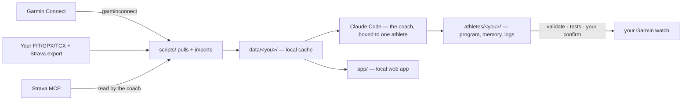

# OpenSportCoach (OSC)

An open-source AI sports coach that runs on your own computer, on top of
[Claude Code](https://claude.com/claude-code). It reads your training data, reviews every session,
plans your week around your goals and races, plans your fuelling, and — if you use Garmin — sends the
structured workouts — gym days, swims, runs, HYROX simulations, mobility — to your watch.

Strength, running, cycling, swimming, triathlon, HYROX-style racing: one coach for all of it.

> **⚠️ Read [`DISCLAIMER.md`](DISCLAIMER.md) first.** OpenSportCoach is not medical advice and not a
> substitute for a doctor or a qualified coach. Its plans come from an AI and can be wrong. You train
> at your own risk. It is free software with **no warranty** ([Apache License 2.0](LICENSE)).

## What it does

- **Every session reviewed.** Lifts against their prescription and trend; rides and runs against their
  intent; swims rep by rep and circuits (HYROX) station by station against the workout they followed.
  Every session gets an execution score.
- **A daily check-in.** Pulls your latest data, reviews any new session against what was planned and
  against your multi-week trend, reads your recovery (or asks how you feel), and proposes today's
  training. Nothing changes without your OK.
- **Programming that evolves.** Your program lives in a plain Python file in your own folder; the coach
  progresses it from what you actually lifted, rode and ran — never from a template.
- **Races.** Add a race; the coach checks its date online, plans the build, the taper and race-week
  fuelling around it, and records the result.
- **Fuelling.** Carbohydrate plans in the products you actually own, scaled to your gut training.
- **Safety rails in code.** Your injuries become tests: a plan that breaks one is refused before it can
  reach you. Nothing is written to your watch without your explicit confirmation.
- **A local web app** with your day, your sessions, your program and your season (`app/`).

## Where your data comes from

| You have | Source | What you get |
|---|---|---|
| A **Garmin** watch or bike computer | `garmin` | Everything: activities, strength sets, laps, streams, sleep, HRV, readiness — and workouts **pushed to your watch** |
| **Any other device or app** (Coros, Wahoo, Polar, Suunto, Apple Watch, Zwift…) | `files` | Your own FIT / GPX / TCX exports, and Strava's free *Download your data* archive. Activities, laps, streams, FIT strength sets |
| **Strava** with a subscription | `strava` | Recent sessions through **Strava's official MCP connector**. Kept 7 days, never GPS. Use with `files` for history |

If you use Garmin, Strava is not read: it would only duplicate your watch. When two sources hold the
same session, the duplicate is detected and the weaker copy removed (`scripts/sources.py`).

**Why not the Strava API?** Strava's API Policy forbids putting data from its API into an AI model's
context. Strava's own MCP connector (for subscribers, for their own data) and your own exported files
are the routes it allows — so those are the only ones OpenSportCoach uses.

## Requirements

- macOS or Linux, Python 3.11+, Node.js 24+ (for the app)
- [Claude Code](https://claude.com/claude-code) and an account with your AI provider. **The parts of
  your data the coach reads are sent to that provider** under your agreement with them.

## Quick start

```bash
git clone https://github.com/<owner>/opensportcoach.git && cd opensportcoach
python3 -m venv .venv
.venv/bin/pip install -r requirements.txt
.venv/bin/python scripts/build_exercise_catalog.py   # builds Garmin's exercise catalog locally
git config core.hooksPath .githooks                  # the privacy and one-athlete-per-commit checks
.venv/bin/python tests/run_tests.py                  # should pass on a fresh clone
claude
```

Then say: **"Hi, I'm Alex — set me up."** The coach runs `/osc-setup`: safety first (you confirm you
are an adult, accept the disclaimer and answer a short health screen), then your data source, goals,
races, injuries, schedule, equipment and fuelling. If you use Garmin, you log in yourself, once, in your
own terminal: `.venv/bin/python scripts/login.py --athlete alex`. Your password never reaches the coach.

After that, every day: **"Alex — run the daily."** See [`GUIDE.md`](GUIDE.md) for everything else.

## Your data stays yours

- Everything about you lives in `athletes/<you>/` and `data/<you>/` on your computer. **Both are
  ignored by this repository** and never committed here. If you want history for your own folder, make
  `athletes/` its own **private** repository.
- `scripts/leak_scan.py`, run by the pre-commit hook, refuses any commit that carries an athlete's name,
  account, workout ids or races outside their folder.
- Several people can share one installation; each session is locked to one athlete, and no script can
  read or write another athlete's files or accounts.

## How it works



- **The coach is Claude Code**, following the workflows in `.claude/skills/` (`/osc-setup`,
  `/osc-daily`, `/osc-week`, `/osc-review`, `/osc-race`, `/osc-push`, …) and the rules in
  [`CLAUDE.md`](CLAUDE.md).
- **Scripts do the fixed work** — pulls, imports, metrics, the workout builder, the validation gate —
  so every number has one definition (`scripts/formulas.py`).
- **Your folder is the coach's memory**: plain Markdown and JSON, readable and editable by you.

More: [`WORKFLOW.md`](WORKFLOW.md) (the daily loop and its gates), [`docs/DESIGN.md`](docs/DESIGN.md)
(why it is built this way), [`workouts/FORMAT.md`](workouts/FORMAT.md) (Garmin workout payloads).

## Contributing

Pull requests are welcome — read [`CONTRIBUTING.md`](CONTRIBUTING.md). Never include anyone's real
training or health data: tests and fixtures use the synthetic Demo athlete only.

## License and trademarks

[Apache License 2.0](LICENSE). See [`NOTICE`](NOTICE).

OpenSportCoach is an independent project, **not affiliated with, endorsed or sponsored by** Garmin,
Strava, Anthropic, Zwift, HYROX, IRONMAN or any other company or event it mentions. All trademarks are
the property of their owners and are used only to describe compatibility. The Garmin integration
relies on the unofficial [`garminconnect`](https://github.com/cyberjunky/python-garminconnect) library.
