<p align="center">
  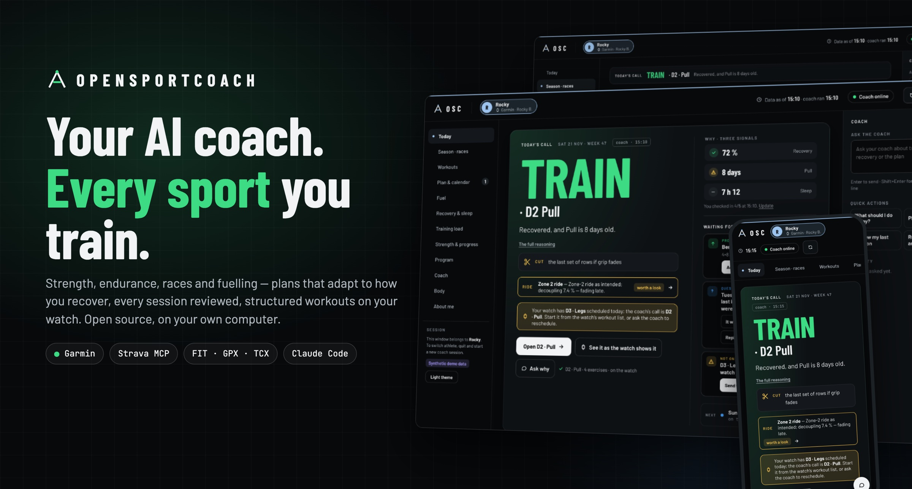
</p>

<p align="center">
  <a href="https://github.com/opensportcoach/opensportcoach/actions/workflows/tests.yml"></a>
  <a href="LICENSE"></a>
  
  
  <a href="DISCLAIMER.md"></a>
</p>

<h3 align="center">A personal coach for strength, endurance, races and fuelling — that reads your watch,<br>plans your week, reviews every session, and puts the workout on your wrist.</h3>

<p align="center">
  <a href="#what-it-does">Features</a> ·
  <a href="#set-it-up">Set it up</a> ·
  <a href="#how-it-works">How it works</a> ·
  <a href="CONTRIBUTING.md">Contribute</a>
</p>

---

**OpenSportCoach** turns [Claude Code](https://claude.com/claude-code) into the coach most athletes never
get to have: one that knows last night's sleep, every set you lifted and every interval you rode, your
races and your injuries — and uses all of it, every morning, to decide what you should do today.

It is not a training-plan template and not another dashboard. It is a coach you talk to:

> **You:** Rocky — run the daily.
>
> **Coach:** Recovered, and Pull is 8 days old: **train — D2 Pull.** Sunday's Zone 2 ride faded in the
> last hour (decoupling 7.4 %) — that's fuel, not fitness: 64 g/h on the next long ride. Bench press
> earned its bump to 82.5 kg. Want D2 on your watch?

Everything runs **on your own computer**. Your training and health data never comes to us — there is no
"us": no server, no account, no subscription. It's free and open source (Apache-2.0).

## What it does

### Today's call — train, adapt or rest, with the reasons

Every morning the coach reads your recovery, what you've done and what's coming, and makes **one
call** with its three reasons. Beside it, everything **waiting for you**: a lift that earned more
weight, a question about yesterday's run, a changed workout that isn't on your watch yet.

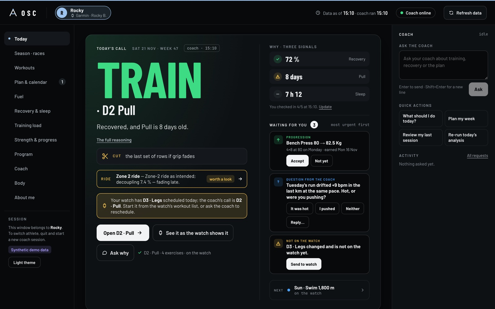

### Ask the coach anything — answers with the numbers behind them

"Has my bench press stalled?" "Can I race the gravel event off this block?" The coach answers in plain
words, and every claim carries the numbers it rests on and where they came from — your watch, or a
formula you can read. Never a number it made up.

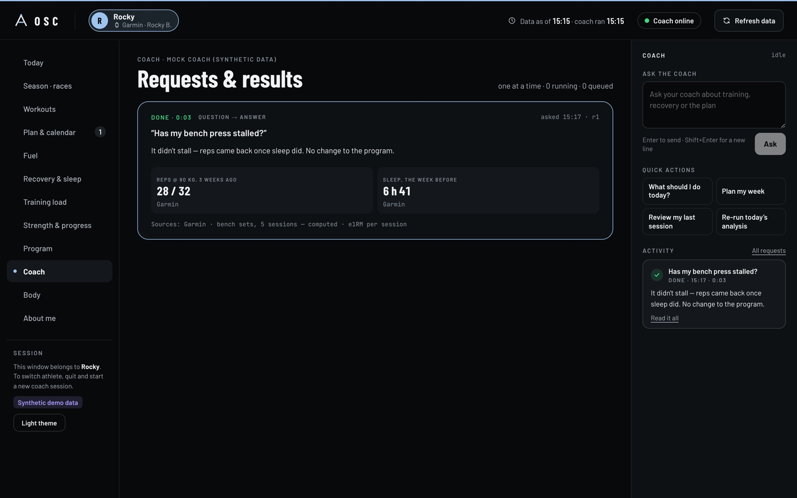

### The plan builder — your week, proposed and explained

Say **"Plan my week"**. The coach proposes the next seven days around your gym days, your long ride,
your races and how you're recovering — every change with its reason. **Accept** it, ask for changes, or
keep your own. Accepted? One click sends the structured workouts to your Garmin watch.

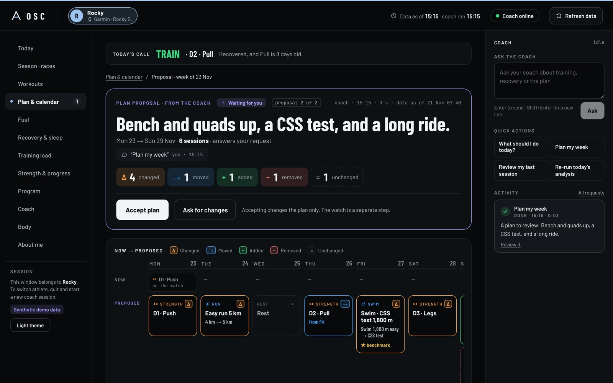

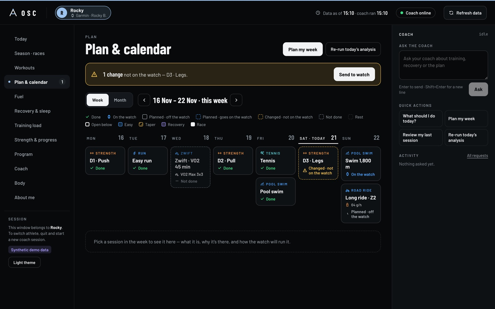

### Your program — progression you can trust

Your gym program lives in a plain file the coach evolves with you: every exercise has the number to
beat, every bump is earned across sessions — never on one good day — and every rule is visible,
including the ones that protect an injury.

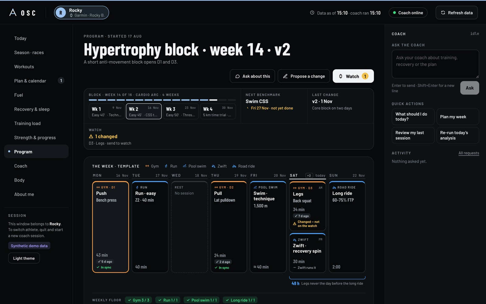

### Season & races — build, taper, race, recover

Add your races — a 10K, a gravel 100, a 70.3, a HYROX in doubles. The coach checks each date online,
plans the build, protects the taper and race week, counts you down, and the day after records your
result with its splits against last year's.

<table><tr>
<td width="50%">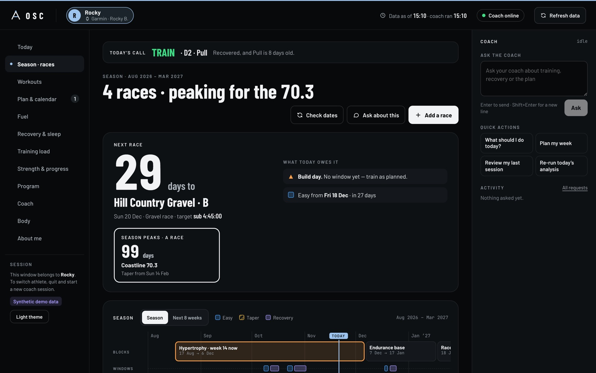</td>
<td width="50%">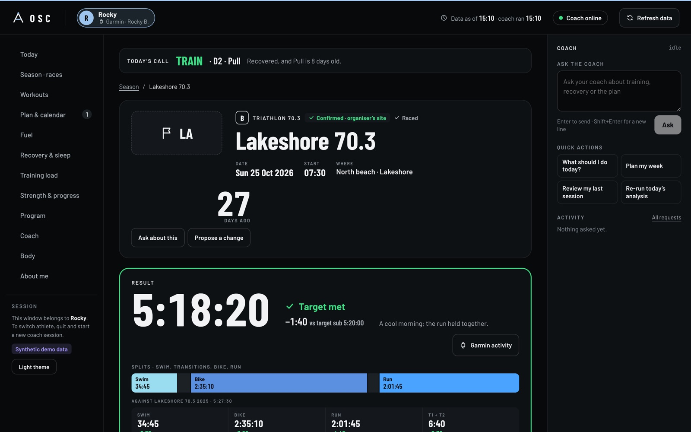</td>
</tr></table>

### Every session reviewed — and scored against the plan

The gym against its prescription, set by set. Rides and runs against their intent — zones, intensity,
pacing, decoupling. **Swims rep by rep. HYROX circuits station by station** — it even catches the lap
button you pressed twice. Every session gets an **execution score**: how it went against what was
planned, not how fit you are.

<table><tr>
<td width="50%">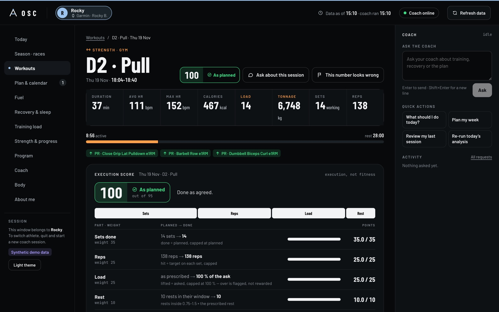</td>
<td width="50%">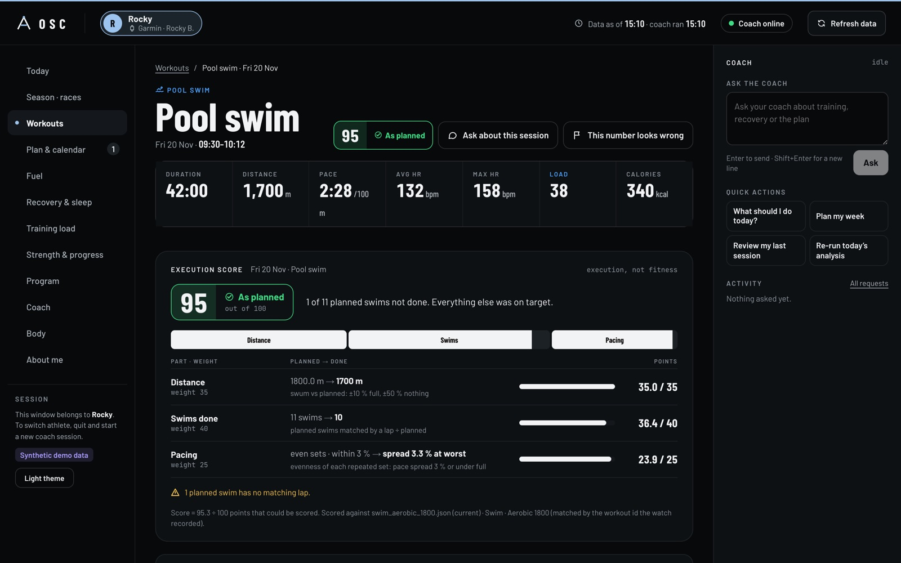</td>
</tr></table>

### Fuel — grams per hour, in the products you actually own

Carbohydrate plans for every long session and race, in **your** gels and drink mixes, scaled to what
your gut is trained to — with a ramp to train it, and a cue sheet for the bike: what to take, and when.

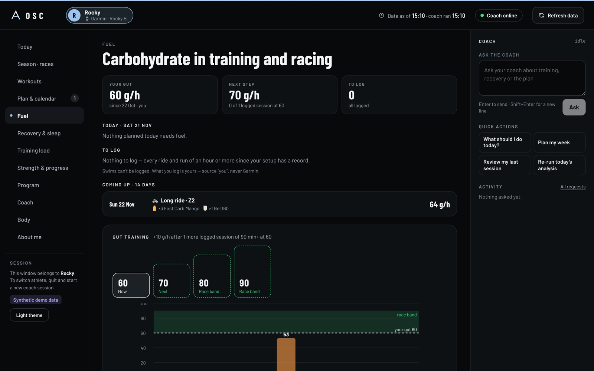

### Recovery, sleep and training load — never one misleading number

A recovery score you can take apart (HRV, resting heart rate, sleep, breathing), sleep against need, and
training load split into **cardio and strength** — because a heavy leg day barely registers in a
watch's heart-rate-based load.

<table><tr>
<td width="50%">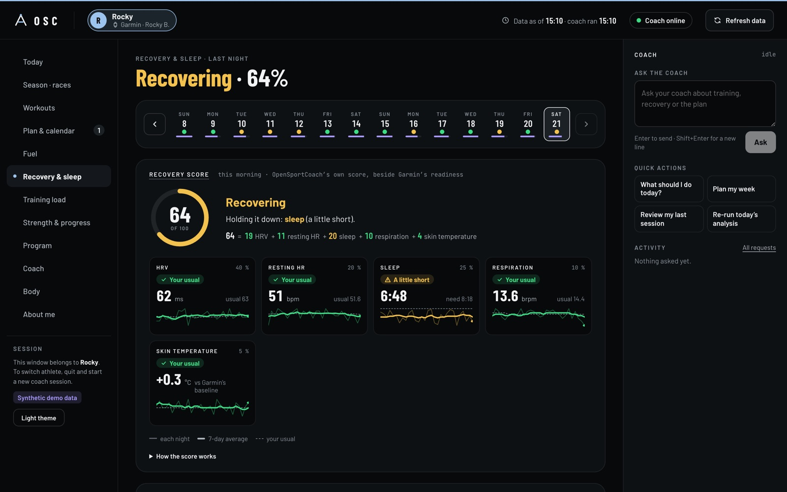</td>
<td width="50%">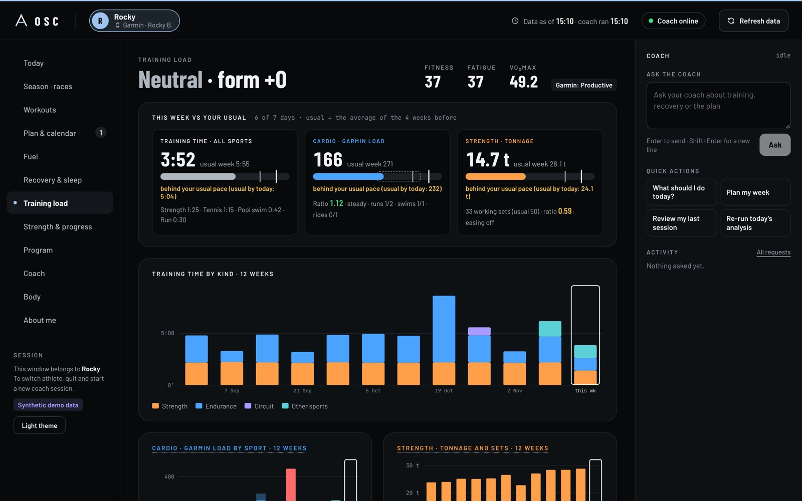</td>
</tr></table>

### On your wrist, on your phone, dark or light

Structured workouts go to your **Garmin** watch — gym days with every exercise named, pool swims, runs
with heart-rate targets, HYROX simulations, mobility routines — only after you confirm. The app works on
your phone and in both themes, and an opt-in, read-only briefing can follow you on claude.ai.

<table><tr>
<td width="26%">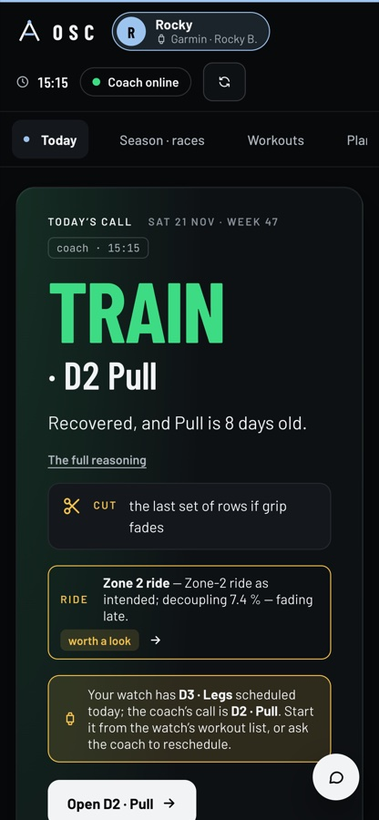</td>
<td width="26%">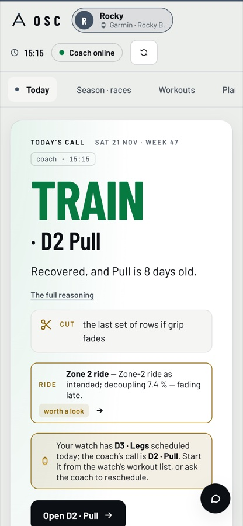</td>
<td width="48%">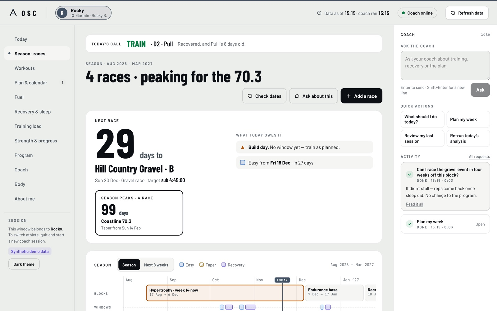</td>
</tr></table>

### Safety, built in — not bolted on

- **No plan before you're set up:** you confirm you're an adult, accept the [disclaimer](DISCLAIMER.md)
  and answer a short health screen; any "yes" means *see a doctor first*, and plans stay conservative.
- **Your injuries become tests.** "No loaded spinal flexion" isn't a note the AI might forget: it's a
  test that refuses any program breaking it — before it can reach your watch.
- **Nothing reaches your watch without your yes**, after a validation gate and the full test suite.
- **It never invents data.** If a pull fails, it says so.

## Works with your setup

| | **Garmin** | **Any device — your own files** | **Strava** (subscribers) |
|---|:---:|:---:|:---:|
| How | your Garmin Connect account | FIT / GPX / TCX from Coros, Wahoo, Polar, Suunto, Apple Watch, Zwift… and Strava's *Download your data* | Strava's official MCP connector |
| Activities: laps, streams, heart rate, power | ✅ | ✅ | summaries of recent sessions, no GPS |
| Strength sets (exercise, reps, load) | ✅ | ✅ from FIT | — |
| Sleep, HRV, readiness | ✅ | — *the coach asks how you feel* | — |
| Workouts sent to your watch | ✅ | — *your plan lives in the app* | — |
| Session reviews and scores | ✅ | ✅ | from the summary |
| Plans, races, fuel, the app | ✅ | ✅ | ✅ |

Use Garmin **or** your files, and add Strava for recent sessions if you don't use Garmin. When two
sources hold the same session, the duplicate is detected and the weaker copy dropped.

> **Why not the Strava API?** Strava's API terms forbid putting its data into an AI model. Its own MCP
> connector and your own exported files are the routes Strava allows — so they're the only ones we use.

## Set it up

**You need:** macOS or Linux · Python 3.12+ · Node.js 24+ · [Claude Code](https://claude.com/claude-code)
with a Claude plan that includes it · about 15 minutes.

**1 · Install** — two ways.

**The easy way: let Claude do it.** Open Claude Code in the folder where you keep your projects and
paste:

```text
Clone https://github.com/opensportcoach/opensportcoach, install it exactly as its README's
"Set it up" section says, run its tests, and tell me when it's ready.
```

Claude clones the repository, creates the Python environment, builds the exercise catalog, installs the
app and runs the test suite — showing you each command first, as your permission settings ask. If
something is missing (Python, Node.js), it tells you what to install.

**Or by hand:**

```bash
git clone https://github.com/opensportcoach/opensportcoach.git && cd opensportcoach
python3 -m venv .venv && .venv/bin/pip install -r requirements.txt
.venv/bin/python scripts/build_exercise_catalog.py     # Garmin's exercise catalog, built on your machine
git config core.hooksPath .githooks                    # privacy and safety checks before every commit
(cd app/web && npm ci) && (cd app/channel && npm ci)   # the app
.venv/bin/python tests/run_tests.py                    # should end with "... passed"
```

**2 · Meet your coach** — start Claude Code **inside** the new folder, so it loads the coach's
instructions and workflows:

```bash
cd opensportcoach && claude
```

Say **"Hi, I'm Rocky — set me up."** (with your own name). The coach runs one setup conversation:

1. **Safety** — you're an adult, you accept the [disclaimer](DISCLAIMER.md), a six-question health screen.
2. **Your data** — Garmin, your own files, or Strava (step 3).
3. **You** — goals, sports, how you train now, races, injuries, the days and time you have, your gym,
   your fuelling. It reads your history first and only asks what the data can't tell it.
4. **Your first plan** — proposed, explained, and only then sent to your watch.

**3 · Connect your data** — you do every login yourself; the coach never sees a password.

- **Garmin:** in your own terminal, `.venv/bin/python scripts/login.py --athlete rocky`
- **Your files:** drop FIT/GPX/TCX in `data/rocky/inbox/`, or import Strava's archive (Strava →
  Settings → My Account → *Download or Delete Your Account* → *Request your archive*):
  `.venv/bin/python scripts/import_files.py ~/Downloads/export_12345.zip`
- **Strava** (subscribers): `claude mcp add --transport http strava-mcp https://mcp.strava.com/mcp`, then
  approve it in your browser.

**4 · Every day**

- In a terminal: `claude`, then **"Rocky — run the daily."**
- With the app: `./scripts/coach.sh`, then **"Rocky — run the app."** It opens in your browser with the
  coach behind every button. *(The app uses Claude Code's channels, a research preview: Claude Code asks
  you to accept a warning when it starts.)*

More in [`GUIDE.md`](GUIDE.md): what you can say, the weekly rhythm, what to do when a number looks wrong.

## How it works

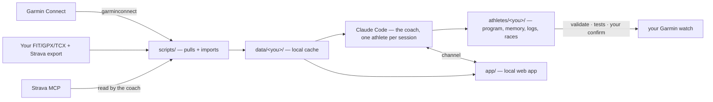

- **The coach is Claude Code**, following the workflows in [`.claude/skills/`](.claude/skills) —
  `/osc-setup`, `/osc-daily`, `/osc-week`, `/osc-review`, `/osc-race`, `/osc-push` — and the rules in
  [`CLAUDE.md`](CLAUDE.md).
- **Scripts do the fixed work** — pulls, imports, metrics, the workout builder, the validation gate — so
  every number has one definition ([`scripts/formulas.py`](scripts/formulas.py)); a written session review
  is checked number by number against what the engine computed before it reaches you.
- **Your folder is the coach's memory**: plain Markdown and JSON you can read and edit — your goals, your
  injuries, your equipment, every session's log.

Design notes: [`docs/DESIGN.md`](docs/DESIGN.md) · the daily loop and its gates:
[`WORKFLOW.md`](WORKFLOW.md) · Garmin workout formats: [`workouts/FORMAT.md`](workouts/FORMAT.md).

## Your data stays yours

- Everything about you lives in `athletes/<you>/` and `data/<you>/` on your computer. **This repository
  ignores both** — they are never committed here. Want version history? Make `athletes/` your own
  **private** repository.
- A leak scan runs before every commit and in CI: it refuses any athlete's name, account, workout ids or
  races outside their own folder.
- Several people can share one installation. Each session is locked to one athlete; no script can read
  or write another athlete's files or accounts.
- What the coach reads is sent to your AI provider under **your** agreement with them — read their
  privacy terms.

## Contributing

Pull requests are welcome — see [`CONTRIBUTING.md`](CONTRIBUTING.md). What would help most: more devices
and file formats, more sports' workout formats, translations of the app, and tests. Never include anyone's
real training or health data — the synthetic athlete Rocky is there for that.

Found a security or privacy problem? Please report it privately: [`SECURITY.md`](SECURITY.md).

## License, disclaimer and trademarks

[Apache License 2.0](LICENSE) — see [`NOTICE`](NOTICE). **OpenSportCoach is not medical advice and comes
with no warranty; you train at your own risk** — read [`DISCLAIMER.md`](DISCLAIMER.md).

OpenSportCoach is an independent project, **not affiliated with, endorsed or sponsored by** Garmin,
Strava, Anthropic, Zwift, HYROX, IRONMAN or any other company or event it mentions. All trademarks are
the property of their owners and are used only to describe compatibility. The Garmin integration relies
on the unofficial [`garminconnect`](https://github.com/cyberjunky/python-garminconnect) library.
